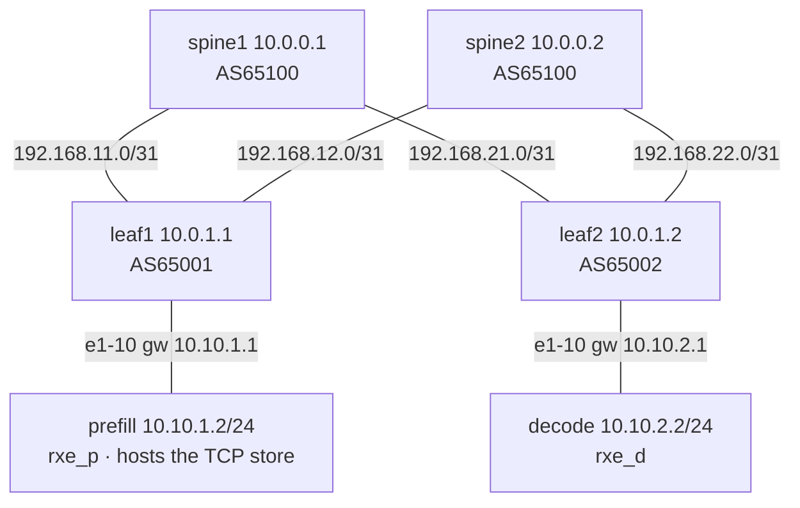
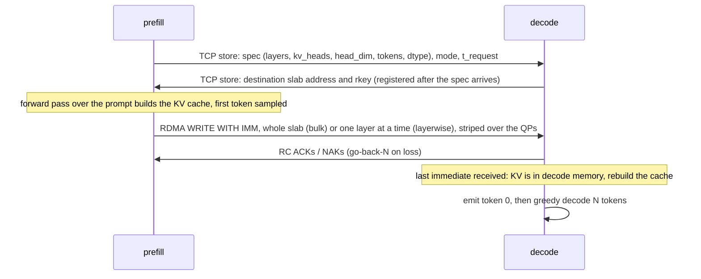

# Disaggregated AI Inference over RoCEv2 on an SR Linux Clos

In disaggregated inference, **prefill** (read the prompt, build the KV cache) and **decode** (generate tokens one at a time) run on different machines. The KV cache that prefill creates must then cross the network before decode can emit its first token. The switches in between see only UDP packets: large, few in number (low entropy) and loss-sensitive.

This lab reproduces that handoff end to end with no GPUs and no RDMA NICs, and follows the layout of [nokia-ai-training-roce-lab](https://github.com/shakeerahmedshaik/nokia-ai-training-roce-lab):

* A **real pretrained LLM** (SmolLM2-135M, 30 layers, 3 KV heads, head dim 64) runs on CPU in two containers. The `prefill` worker processes the prompt and builds the real KV tensors.
* The KV cache moves to the `decode` worker as **real RoCEv2**: UDP/4791, InfiniBand BTH/RETH, RC queue pairs and ACKs, generated by Linux **Soft-RoCE (`rxe`)** on each worker's `eth1`. The transfer is an RDMA WRITE push into memory that decode registered, with the final WRITE carrying an immediate, the "WRITE (push)" example of Learning Byte 04. Only the bootstrap and request metadata use TCP.
* The fabric is a minimal **2-leaf / 2-spine SR Linux Clos** with an eBGP underlay and 2-way ECMP. A RoCE QoS profile is applied: DSCP 26 for data in an ECN-enabled queue, DSCP 48 for CNP in strict priority.

The lab then measures what an AI fabric engineer cares about: whether the answer after the handoff is exactly the answer without it, how much of the first-token time is the network, wire bytes compared with KV bytes, per-QP ECMP placement, loss and go-back-N retransmission, the effect of sender pacing, layer-by-layer streaming, and a spine-link failure in the middle of a transfer.

The background lessons are in [ai-inference-learning-bytes](https://github.com/shakeerahmedshaik/ai-inference-learning-bytes) (Lessons 03 and 04).

**[Interactive walkthrough](docs/index.html)** of one request on the wire: each phase on the Clos diagram, per-opcode frame anatomy and the result charts, using the data in [`outputs/`](outputs). The repository is private and GitHub Pages is not enabled, so GitHub only shows the page's source. To view it, clone the repo and run:

```bash
bash scripts/serve-docs.sh        # serves docs/ on http://localhost:8000
```

If the repo is cloned on a remote host, forward the port first (for example `ssh -L 8000:localhost:8000 <host>`), then open `http://localhost:8000`. The page is one self-contained file (no CDN), so opening `docs/index.html` directly in a browser also works.

## Topology



| Item | Value |
| --- | --- |
| Switches | 4 x SR Linux `ghcr.io/nokia/srlinux:26.7.2`, type `ixr-h5-64o` (7220 IXR-H5-64O, Tomahawk 5) as the TH6 stand-in. See [Platform: TH6 vs TH5](#platform-th6-vs-th5) |
| Workers | 2 x `python:3.11-slim` (Debian 13). PyTorch 2.14 CPU, transformers 4.46.3, rdma-core 56.1, perftest and pyverbs on the system python3 (3.13) |
| Model | SmolLM2-135M (`LlamaForCausalLM`, fp32 weights): 30 layers, 9 attention heads, **3 KV heads**, head dim 64. Greedy decoding, fixed seed, 4 torch threads |
| KV size | `2 x layers x kv_heads x head_dim x tokens x dtype_bytes` = **46,080 B per token** in fp32, 23,040 B in fp16 |
| Underlay | eBGP over /31 links. Spines AS65100, leaves AS65001/65002. Accept-all policy (closed lab fabric), multipath ebgp maximum-paths 2 |
| MTU | Worker eth1 9000, SR Linux subinterface ip-mtu 9000, RoCE path MTU 4096 |
| QoS | Classifier ROCE: DSCP 26 to fc3/unicast-3 (WRED with ECN, 5-20 %), DSCP 48 to fc6/unicast-6 (strict priority) |
| Transfer | RDMA WRITE WITH IMMEDIATE over 1 to 4 RC QPs (channels), traffic class 0x6a (DSCP 26, ECT(0)). `bulk` pushes the whole slab after prefill, `layerwise` pushes each layer as soon as it is computed |

## How a request moves



`app/kvlayout.py` defines the slab: `[layer 0: K | V][layer 1: K | V] ...`, each tensor `[kv_heads, tokens, head_dim]`. One layer is one contiguous byte range (what a layer-wise WRITE pushes) and the whole slab is one contiguous range (what a bulk WRITE pushes). `app/kv_transport.py` registers the slab as an RDMA memory region and stripes each range across the channels. Every channel is its own RC QP, so it gets its own UDP source port and the fabric can hash it onto a different spine.

**Definitions used in every result below** (the two workers share one host clock, so cross-container timestamps are valid):

* `prefill_ms`: the forward pass over the prompt. In `layerwise` mode it includes posting the WRITEs from inside the forward pass.
* `exposed_transfer_ms`: time after prefill (and, in bulk mode, after packing) until every WRITE is acknowledged. This is the network time the user waits for. It is not the whole transfer when the transfer overlaps compute.
* `ttft_ms` (disaggregated): `max(KV fully in decode memory, first token published) - request start`. Decode emits token 0 once it holds the whole cache. Colocated TTFT is `prefill_ms`.
* `wire_MB`: every RoCEv2 frame in both directions on `prefill` eth1 (original frame lengths). `wire/kv` is the amplification over the KV bytes.
* `tokens_and_kv_match`: the generated token ids equal the colocated reference for the same prompt and KV dtype, and the prefill and decode `crc32` of the KV slab are equal.

## Results

Everything below was measured in this lab and the raw output is in `outputs/` (file names in brackets). The final numbers come from a **quiet host**: the other CPU-heavy container on the VM (`try-c9s-control-plane`, a kind cluster using about 180 % of a CPU) was paused with `docker pause` for the runs and resumed afterwards. An earlier pass with it running (load average 15 to 22) gave prefill times of 4.3 to 7.0 s for 512 tokens, against 2.7 to 3.1 s when it was paused, so the loaded numbers were wrong by up to 2x. That pass is kept for comparison in `outputs/expC-ttft-*-loaded-host.txt`. The host still runs the SR Linux software datapath spinners (`sr_xdp_lc`, about 4 cores), so **single runs still vary by tens of percent**: that is why Experiments C and E repeat each configuration and show every run.

### Experiment A: anatomy of one request on the wire (32 tokens, fp32, bulk, 2 channels) [`expA-*`]

The KV slab is 1,474,560 B (32 tokens x 46,080 B). It was pushed as two 737,280 B stripes, one WRITE per RC QP.

| Observation | Value |
| --- | --- |
| RoCEv2 frames, both directions | 672 frames, 2,750,620 B (**1.87x** the KV bytes) |
| Data frames (opcodes 6, 7, 9) | 662. The ideal is 360 = 2 stripes x (1 First + 178 Middle + 1 Last), so 302 were retransmitted |
| Conversations | `10.10.1.2:55830 -> 10.10.2.2:4791` 373 frames, `10.10.1.2:55183 -> 10.10.2.2:4791` 289 frames. A different UDP source port per QP is the ECMP entropy |
| First WRITE frames | opcode 6 (First) with RETH `dmalen 737280` on each QP, destination QPs `0x143` and `0x144`, then opcode 7 (Middle) frames. The last frame of a stripe is opcode 9 (WRITE Last with Immediate) |
| Marking | DSCP 26, ECN 2 (ECT(0)), TTL 64 leaving prefill and 61 arriving from decode, so three routed hops. No CE marks |
| ECMP | spine1 carried 1.0 MB and spine2 1.4 MB: the two QPs hashed to different spines |
| TCP | 43 frames, 3,673 B: the TCP store carries only the spec, the MR address and rkey, the first token and "done" |
| Timing | prefill 218 ms, `push_done` 348 ms, exposed transfer 129 ms, decode TTFT 351 ms |

### Experiment B: is the answer after the handoff the same answer? (128 tokens, fp32, bulk) [`expB-*`]

| Check | Result |
| --- | --- |
| KV slab crc32 (colocated, prefill, decode) | `e9051a60` on all three |
| Generated token ids, disaggregated vs colocated | identical |
| Control: decode ignores the received KV (`--control zero-kv`) | tokens diverge, so the KV, and nothing else, carries the state |

The 5,898,240 B KV cost 11,982,912 B of RoCEv2 on the wire (2,928 frames, **2.03x**): 2,884 data frames against an ideal 1,440, plus 44 ACKs or NAKs. TCP was 3.6 KB. leaf1 `ethernet-1/10` discarded 389 packets during the run. `rxe` on prefill counted 17 more sequence errors and 17 more completer retries, and decode counted 17 more out-of-sequence requests (`retry_exceeded_err` stayed 0), which is go-back-N at work. Both QPs were spread over both spines (5.3 MB and 5.0 MB). The prefill time in this run (1,167 ms against 665 ms colocated) was taken with `tcpdump` running and is not representative: Experiment C has no capture and shows 761 ms against 698 ms.

### Experiment C: time to first token, colocated vs disaggregated (medians of 5) [`expC-ttft-128.txt`, `expC-ttft-512.txt`]

| Prompt | Configuration | TTFT (ms) | prefill (ms) | exposed transfer (ms) |
| --- | --- | ---: | ---: | ---: |
| 128 tokens | colocated | 698 | 698 | 0 |
| 128 tokens | disaggregated, bulk | 1,076 | 761 | 299 |
| 128 tokens | disaggregated, layerwise | 1,415 | 1,208 | 163 |
| 128 tokens | disaggregated, layerwise, paced 300 Mbit/s | 812 | 769 | 6 |
| 512 tokens | colocated | 2,773 | 2,773 | 0 |
| 512 tokens | disaggregated, bulk | 4,427 | 3,018 | 1,354 |
| 512 tokens | disaggregated, layerwise | 3,394 | 2,950 | 194 |
| 512 tokens | disaggregated, layerwise, paced 300 Mbit/s | 3,225 | 3,089 | 102 |

512 tokens, every run (ms):

| Run | colocated TTFT | bulk TTFT (exposed) | layerwise TTFT (exposed) | layerwise + pace 300 TTFT (exposed) |
| --- | ---: | ---: | ---: | ---: |
| 1 | 2,773 | 4,008 (1,256) | 3,059 (35) | 3,225 (102) |
| 2 | 2,726 | 4,427 (1,354) | 3,180 (191) | 2,957 (31) |
| 3 | 2,701 | 3,928 (920) | 3,394 (450) | 3,553 (201) |
| 4 | 3,956 | 5,429 (1,479) | 4,393 (194) | 4,487 (102) |
| 5 | 3,474 | 5,177 (1,410) | 3,473 (575) | 3,010 (20) |

What the data supports:

* **Splitting is not automatically faster.** Colocated had the lowest TTFT in 4 of 5 runs at 512 tokens, and the disaggregated TTFT is the colocated prefill plus whatever of the transfer is still exposed.
* **Bulk push is always the slowest** (5 of 5 runs): it adds about 0.3 s at 128 tokens (+54 % TTFT) and about 1.35 s at 512 tokens (+60 %), the whole transfer sitting after prefill.
* **Layer-by-layer push hides most of the transfer** (exposed 6 to 575 ms), and **layerwise with pacing is the best disaggregated configuration**, +16 % over colocated at both lengths (and below colocated in run 5). Unpaced layerwise at 128 tokens is worse than bulk (1,415 ms): its `prefill_ms` rises to 1,208 ms because Soft-RoCE's retransmission work runs on the same CPU as the forward pass. On GPUs with RDMA NICs that competition does not exist.

### Experiment D: sweeps, one variable at a time (512 tokens unless noted) [`sweeps.txt`]

`wire/kv` is wire bytes divided by KV bytes. Every row passed `tokens_and_kv_match`. These are single runs, so differences under about 30 % are noise (Experiment E repeats one row three times to show the spread).

| Sweep | Value | KV (MB) | wire/kv | exposed transfer (ms) | leaf discards |
| --- | --- | ---: | ---: | ---: | ---: |
| prompt length | 32 | 1.5 | 2.90 | 171 | 284 |
| prompt length | 128 | 5.9 | 1.95 | 381 | 444 |
| prompt length | 512 | 23.6 | 2.23 | 1,278 | 1,962 |
| prompt length | 1024 | 47.2 | 1.58 | 1,643 | 1,360 |
| KV dtype | fp32 | 23.6 | 1.87 | 1,033 | 1,757 |
| KV dtype | fp16 | 11.8 | 1.81 | 492 | 656 |
| channels (RC QPs) | 1 | 23.6 | 1.62 | 923 | 807 |
| channels (RC QPs) | 2 | 23.6 | 2.09 | 1,056 | 1,472 |
| channels (RC QPs) | 4 | 23.6 | 3.20 | 1,379 | 3,770 |

* KV bytes grow linearly with the prompt (46,080 B per token) and the exposed transfer grows with them. fp16 halves the KV bytes and the exposed transfer (2.1x); the fp16 tokens still match the colocated fp16 reference.
* **More channels made it worse, not better.** The bottleneck is the software datapath, not a single QP: wire/kv rose from 1.62 to 3.20 and the exposed transfer from 923 to 1,379 ms. In all three rows every flow landed on a single spine (spine1, spine2 and spine1 respectively), even with 4 QPs, so extra QPs did not buy any ECMP spread: that depends on the hash, not the QP count.

### Experiment E: bulk vs layerwise push, three repetitions (512 tokens) [`sweeps.txt`]

| Mode | exposed transfer, runs 1/2/3 (ms) | TTFT, runs 1/2/3 (ms) | prefill, runs 1/2/3 (ms) | wire/kv, runs 1/2/3 |
| --- | --- | --- | --- | --- |
| bulk | 676 / 1,400 / 787 | 3,623 / 5,247 / 3,608 | 2,902 / 3,785 / 2,770 | 1.63 / 2.35 / 1.85 |
| layerwise | 194 / 432 / 245 | 4,848 / 3,451 / 3,435 | 4,595 / 2,979 / 3,151 | 3.42 / 2.97 / 2.54 |

Layerwise cut the exposed transfer by 69 to 71 % in every repetition. Its TTFT was better than bulk in 2 of 3 runs; the exception is run 1, where its `prefill_ms` spiked to 4,595 ms. Layerwise also put more bytes on the wire (2.5 to 3.4x against 1.6 to 2.4x), because several WRITEs overlap and overflow the software datapath more often. Note the spread inside one configuration: the bulk exposed transfer ranged from 676 to 1,400 ms.

### Experiment F: loss, pacing, delay and transport (512 tokens) [`sweeps.txt`]

| Sender pacing (`tc tbf`) | wire/kv | leaf discards | exposed transfer (ms) | KV / rate (ms, arithmetic) |
| --- | ---: | ---: | ---: | ---: |
| off | 1.64 | 962 | 895 | n/a |
| 60 Mbit/s | 1.01 | 0 | 3,184 | 3,146 |
| 100 Mbit/s | 1.04 | 0 | 2,036 | 1,888 |
| 150 Mbit/s | 1.06 | 0 | 1,433 | 1,259 |
| 200 Mbit/s | 1.06 | 2 | 1,025 | 944 |
| 300 Mbit/s | 1.03 | 0 | 653 | 629 |
| 400 Mbit/s | 1.19 | 31 | 593 | 472 |

The last column is arithmetic (23,592,960 B x 8 / rate), not a measurement. At 60 to 300 Mbit/s the transfer takes close to the time the pacer allows (within 15 %) and the fabric drops nothing, so the wire carries the KV once (1.01 to 1.06x). **Pacing at 300 Mbit/s beat unpaced on both counts**: 653 ms against 895 ms exposed transfer (and 24.3 MB against 38.8 MB on the wire). At 400 Mbit/s the loss starts again (31 discards, 1.19x). The knee of this software datapath is therefore between 300 and 400 Mbit/s. Below it, pacing trades time for zero loss; this is the job that DCQCN or PFC does on a real fabric, and with no ECN here it has to be set by hand.

| Other variable | Value | wire/kv | exposed transfer (ms) | leaf discards |
| --- | --- | ---: | ---: | ---: |
| netem delay on decode | 0 ms | 2.41 | 1,352 | 2,458 |
| netem delay on decode | 5 ms | 2.01 | 1,125 | 1,528 |
| netem delay on decode | 20 ms | 1.76 | 1,660 | 1,503 |
| transport | RoCEv2 RDMA WRITE (unpaced) | 1.59 | 832 | 882 |
| transport | TCP (same fabric, same bytes) | 1.02 | 272 | 20 |

Delay: no clear effect up to 5 ms, and +23 % at 20 ms over the 0 ms row; the 0 ms row itself (1,352 ms) is higher than the other unpaced rows in this sweep (832 to 1,278 ms), so delay effects of this size are inside the run-to-run noise. **TCP finished about 3x faster than unpaced Soft-RoCE** (272 against 832 ms) on this fabric, because TCP's congestion control backs off on loss and Soft-RoCE has none. This is a statement about Soft-RoCE on a software datapath with no PFC or DCQCN, not about RoCE on a lossless fabric.

### Experiment G: a spine link fails in the middle of a KV transfer [`failover.txt`, `failover-repeat2.txt`, `failover-repeat3.txt`]

Five 1024-token requests, paced at 100 Mbit/s. The script learns which leaf1 uplink the transfers use from transfer #2, then disables it (`leaf1 ethernet-1/1`) 1.5 s into transfer #3 and re-enables it about 16.5 s later. Three runs, with the third request's cost compared with the other four:

| Run | req 2 exposed transfer (ms) | other four, exposed transfer (ms) | req 2 TTFT minus KV-ready (ms) | tokens and KV crc32 |
| --- | ---: | --- | ---: | --- |
| 1 | 3,976 | 3,832 to 4,091 | 2,387 | identical, `db7b0412` |
| 2 | 4,064 | 3,826 to 3,922 | 9 | identical, `db7b0412` |
| 3 | 6,716 | 3,827 to 3,963 | 9 | identical, `db7b0412` |

* **The failure costs between nothing and about 2.8 s, and every request completes correctly.** In run 3 the transfer itself took 2.8 s longer. In run 1 the transfer was not slower, but decode received the first token 2.4 s after the KV was ready; the first token travels over the TCP store, which also crosses the fabric. In run 2 nothing was visible. The three runs differ because every transfer opens new QPs with new UDP source ports, so whether its flows were on the failed uplink depends on the hash. The counters do not show which flows crossed the dead link, so this attribution is a likely explanation, not a measured one.
* After the fault, leaf1 had one next-hop for `10.10.2.0/24` (`via 192.168.12.1`). Two next-hops returned 20, 30 and 26 s of polling after the link was re-enabled.
* `retry_exceeded_err` stayed 0 on both sides: the RC retry budget outlasted the reroute, so no QP went into the error state and no request had to be restarted. In run 1 prefill counted 15 more sequence errors and 13 more completer retries, and decode counted 142 more duplicate requests.

### What a faster fabric would change (arithmetic, not measured)

The measured fabric moves the KV at roughly 0.2 to 0.7 Gbit/s, which is why the transfer is visible at all. For the handoff alone, at line rate and ignoring protocol overhead:

| KV cache | Bytes | 100 Gb/s | 400 Gb/s | 800 Gb/s | 1.6 Tb/s |
| --- | ---: | ---: | ---: | ---: | ---: |
| SmolLM2-135M, 512 tokens, fp32 | 23.6 MB | 1.89 ms | 0.47 ms | 0.24 ms | 0.12 ms |
| Llama-3-8B-class (32 layers, 8 KV heads, head dim 128), 8,192 tokens, fp16 | 1.07 GB | 85.9 ms | 21.5 ms | 10.7 ms | 5.4 ms |

On a real lossless fabric the question moves from "how fast is the wire" to "how many KV caches arrive at once, and what do they do to each other's tail". The second row is the shape of the problem: large, bursty, few flows. This lab does not test that.

## Deploying the lab

The lab runs with containerlab. `topology.clab.yml` describes the topology, and every switch boots with its startup config from `configs/`.

Soft-RoCE is a host kernel facility, so load it once on the containerlab host **before** deploying:

```bash
sudo modprobe rdma_rxe ib_uverbs sch_netem

# fetch the model once on the host (about 260 MB); it is bind-mounted read-only at /models in both workers
bash scripts/fetch-model.sh

# deploy the lab
containerlab deploy -t topology.clab.yml

# install worker packages, address eth1, create rxe devices, apply RoCE QoS, verify the fabric
bash setup.sh

# destroy the lab
containerlab destroy -t topology.clab.yml --cleanup
```

With the VS Code containerlab extension, open the topology file and click **Deploy**. `topology.clab.yml.annotations.json` holds the Clos layout for the graph view, with spines on top and workers at the bottom. SR Linux needs about 1-2 minutes to boot. `setup.sh` downloads about 250 MB of PyTorch per worker and is intended for a fresh deployment. The lab name, management subnet (172.30.41.0/24) and rxe device names (`rxe_p`, `rxe_d`) differ from the training lab, so the two labs can be deployed side by side, though they then compete for the host's CPUs.

### clabernetes (Kubernetes)

`c9s/ai-inference-c9s.yaml` is the clabverter rendering of this topology (a Namespace, the startup configs and `app/` and `prompts/` files as ConfigMaps, and the Topology resource). It was generated, **not deployed or tested**.

```bash
# regenerate after changing the topology, configs or app/ (the models bind is removed first: 260 MB does not fit in a ConfigMap)
grep -v 'models:/models' topology.clab.yml > /tmp/topology.clab.yml   # run from a directory that also holds app/ configs/ prompts/
docker run --rm --user $(id -u) -v $(pwd):/clabernetes/work \
    ghcr.io/srl-labs/clabernetes/clabverter --stdout --naming non-prefixed \
    --topologyFile topology.clab.yml --destinationNamespace ai-inference |
    sed 's|\${SRL_IMAGE:=\([^}]*\)}|\1|' > c9s/ai-inference-c9s.yaml
```

Kubernetes has constraints the containerlab host does not:

* Soft-RoCE still lives in the host kernel, so run `sudo modprobe rdma_rxe ib_uverbs` on **every cluster node** that can schedule a worker pod.
* The model is not in the manifest. Each worker has internet access, so download it inside the pod to `/models/SmolLM2-135M` (the same eight files as `scripts/fetch-model.sh`), or mount it from a PersistentVolume.
* `setup.sh`, `run.sh` and `scripts/` drive the containers with `docker exec`. On a cluster, run their commands with `kubectl exec` into the worker and switch pods.

## Accessing the network elements

```bash
ssh admin@clab-ai-inference-leaf1
ssh admin@clab-ai-inference-spine1
docker exec -it clab-ai-inference-prefill bash
docker exec -it clab-ai-inference-decode bash
```

| Script | Purpose |
| --- | --- |
| `run.sh infer.py [args] [--wait]` | Starts decode on `decode` and prefill on `prefill`, then prints both `/tmp/infer.log` files. `--role colocated` runs the no-network reference on `prefill`. With `--wait` a wedged or crashed peer is detected and the run is retried once |
| `scripts/compare.sh [tokens] [new]` | Experiment B: colocated, disaggregated (with capture and counters) and the negative control, with a PASS/FAIL verdict |
| `scripts/ttft.sh [tokens] [reps]` | Experiment C: TTFT medians for colocated, bulk, layerwise and layerwise with pacing |
| `scripts/sweep.sh [group...]` | One-variable-at-a-time sweeps, one summary row per run. Groups: `tokens dtype channels mode pacing delay transport` |
| `scripts/failover.sh` | Spine-link failure during a multi-request run |
| `scripts/run-all.sh` | Every experiment above, in order (about 1.5 hours) |
| `scripts/capture.sh start\|stop <name> [--snap N]` | tcpdump on `prefill` eth1, copied to `captures/<name>.pcap` |
| `scripts/analyze.sh <pcap>` | tshark worksheet: totals, conversations, frame sizes, BTH opcodes per QP, DSCP/ECN/TTL, WRITE detail, I/O graph |
| `scripts/fabric.sh [counters]` | BGP sessions, ECMP routes, spine interface counters |
| `scripts/ecmp-delta.py before after` | Spine byte deltas between two `fabric.sh counters` snapshots |
| `scripts/rxe-stats.sh` | Soft-RoCE transport counters (retransmission indicators) and leaf ingress discards |
| `scripts/pace.sh <rate>\|off` | Token-bucket pacing on both workers (stands in for NIC rate control) |
| `scripts/netem.sh add <ms>\|del` | netem delay on `decode` eth1 |
| `scripts/fetch-model.sh [hf-repo]` | Download the model once on the host |
| `scripts/serve-docs.sh [port]` | Serve the interactive walkthrough (`docs/index.html`) on `http://localhost:8000` |

`infer.py` options: `--role prefill|decode|colocated`, `--prompt-tokens N`, `--max-new-tokens N`, `--kv-dtype fp32|fp16`, `--mode bulk|layerwise`, `--channels N`, `--transport roce|tcp`, `--requests N`, `--control zero-kv` (decode only: throw the received KV away).

## Configuration

### Fabric

Each leaf peers with both spines over /31 links and exports its worker subnet. Here is leaf1 (trimmed):

```
set / interface ethernet-1/10 subinterface 0 ip-mtu 9000
set / interface ethernet-1/10 subinterface 0 ipv4 address 10.10.1.1/24
set / interface ethernet-1/1 subinterface 0 ipv4 address 192.168.11.0/31
set / interface ethernet-1/2 subinterface 0 ipv4 address 192.168.12.0/31
set / network-instance default protocols bgp autonomous-system 65001
set / network-instance default protocols bgp afi-safi ipv4-unicast multipath ebgp maximum-paths 2
set / network-instance default protocols bgp neighbor 192.168.11.1 peer-as 65100
set / network-instance default protocols bgp neighbor 192.168.12.1 peer-as 65100
```

### RoCE QoS

`configs/qos-roce.cli` is committed by `setup.sh` on all four switches, with each fabric port's subinterface classifier and output queues bound to it:

```
A:leaf1# info qos classifiers dscp-policy ROCE
    dscp 26 {
        forwarding-class fc3
        drop-probability low
    }
    dscp 48 {
        forwarding-class fc6
        drop-probability low
    }
```

On IXR-H5, `queue-management-profile` on an output queue is rejected unless a `buffer-allocation-profile` sets the queue's `maximum-burst-size`. `enable-ecn` and `slope-enabled` are list keys of `wred-slope`, not leaves.

### Workers

`setup.sh` gives each worker an `rxe` device on `eth1`. Each device has a RoCE v2 GID at index 1, for example `::ffff:10.10.1.2`. The workers are privileged, but `/dev/infiniband/uverbs*` appears on the host only after the device is created, so `setup.sh` also runs `mknod` for those nodes inside each container.

## Platform: TH6 vs TH5

The SR Linux 26.7.2 image recognizes `type: ixr-h6` as the **7220 IXR-H6-64**, the Tomahawk 6 platform. Without a license it stops every application about 20 s after boot, and the container exits. The IXR-H5 types run unlicensed, so this lab uses `ixr-h5-64o` (7220 IXR-H5-64O, Tomahawk 5). To run on IXR-H6, put an SR Linux license file next to the topology and set the following on the four switches:

```
      type: ixr-h6
      license: license.key
```

Either way, containerlab runs SR Linux's control plane and a software forwarding model. It does **not** model Tomahawk queues, MMU headroom, ECN thresholds, PFC state machines, packet trimming, or 400G/800G timing (the ports report 800G but forward in software).

## What this does NOT test

* **No GPUs and none of the production stack.** No vLLM, NIXL, UCX, GPUDirect RDMA, NVLink or a real RDMA NIC. The KV bytes are real (a real model's attention state) and so are the RoCEv2 frames, but the model runs on CPU and the transport is Soft-RoCE written through pyverbs.
* **Absolute speed.** Soft-RoCE and the SR Linux software datapath run at roughly 0.2 to 0.7 Gbit/s here. Use the ratios (`wire/kv`, exposed transfer against KV size, paced against unpaced) and the correctness checks, not the milliseconds, as evidence. The "What a faster fabric would change" table is arithmetic.
* **No ECN, DCQCN or PFC.** The QoS profile is configured and the queues exist, but the software datapath never marked a frame CE (Experiment A, 0 CE), so there is no congestion feedback and the sender has to be paced by hand. A lossless fabric would show far less of the go-back-N amplification seen here.
* **Multi-tenant interference.** One request at a time, one prefill and one decode worker. Many prefill workers incasting into one decode worker, head-of-line effects and tail latency under load are not tested.
* **Real model scale.** 135M parameters with 3 KV heads gives a small KV (46,080 B per token). Production models with more layers and heads, long contexts, paged KV blocks and prefix caching change the size, the number and the shape of the transfers.
* **A fully quiet host.** The final runs paused the one other heavy container, but the VM is still shared and the SR Linux software datapath keeps about 4 cores busy. Single runs vary by tens of percent (colocated 512-token TTFT ranged from 2,701 to 3,956 ms), so the experiments repeat and the README shows every run where the ordering matters.

## Notes and gotchas

* **Time on a busy host is wrong, not just noisy.** With another workload running (load average 15 to 22), the same 512-token prefill took 4.3 to 7.0 s instead of 2.7 to 3.1 s. Pause other CPU-heavy containers before measuring (`docker pause <name>`, `docker unpause <name>` afterwards). `scripts/run-all.sh` documents this, and `outputs/expC-ttft-*-loaded-host.txt` keeps the loaded-host pass for comparison.
* **Poll loops must sleep.** An early version busy-polled completions on the same cores as the forward pass and made prefill about 2x slower at 128 tokens. `POLL_SLEEP` (0.5 ms) in `app/kv_transport.py` fixed it. The evidence for the artifact is kept in `outputs/artifact-busypoll-ttft-128.txt`.
* **A rare hang.** Once in the runs the prefill process vanished silently and decode waited forever. It did not reproduce in six tries. `run.sh --wait` therefore supervises both sides (a lone survivor for 30 s, or a 900 s timeout, kills the run, prints the logs and retries once on a new store port), and the workers run with `faulthandler` enabled.
* **The KV is compared before it is trusted.** `crc32` of the slab on both sides and the generated token ids against a colocated reference at the same KV dtype (the colocated path quantizes at the same point). A zero-KV control must diverge.
* **Tokens must match at fp16 only because the reference quantizes too.** fp16 KV is lossy in general; the check compares like with like.
* **`sr_cli` startup costs about 2.8 s per call,** so the failover script keeps one persistent session and learns the uplink in use from earlier transfers.
* **ECMP is a hash.** Two QPs can land on the same spine (in the channel sweep every flow used a single spine, even with 4 QPs). Counters in `fabric.sh` show where each run went.
* **The clabernetes manifest in `c9s/` was generated but not deployed or tested.** The 260 MB model does not fit in a ConfigMap, so the manifest excludes the `models` bind and the model has to be supplied inside the cluster (for example from a volume).
* **Soft-RoCE needs the `rdma_rxe` kernel module on the host** and uses the caller's CPU for protocol work, so `TORCH_THREADS` (default 4) and the host load affect the numbers.

## Raw outputs

Full, unedited command outputs from a run of this lab are in `outputs/`. Captures go to `captures/`, which is git-ignored.

## References

* [ai-inference-learning-bytes](https://github.com/shakeerahmedshaik/ai-inference-learning-bytes): Lesson 03 (disaggregated inference) and Lesson 04 (KV-cache transfer)
* [nokia-ai-training-roce-lab](https://github.com/shakeerahmedshaik/nokia-ai-training-roce-lab): the sibling lab this one follows
* [NVIDIA NIXL architecture](https://docs.nvidia.com/nixl/getting-started/architecture/)
* [linux-rdma/rdma-core](https://github.com/linux-rdma/rdma-core) (rxe, pyverbs) · [perftest](https://github.com/linux-rdma/perftest)
* InfiniBand Architecture Specification, Annex A17: RoCEv2
* [containerlab](https://containerlab.dev) · [SR Linux](https://learn.srlinux.dev) · [SmolLM2](https://huggingface.co/HuggingFaceTB/SmolLM2-135M)
