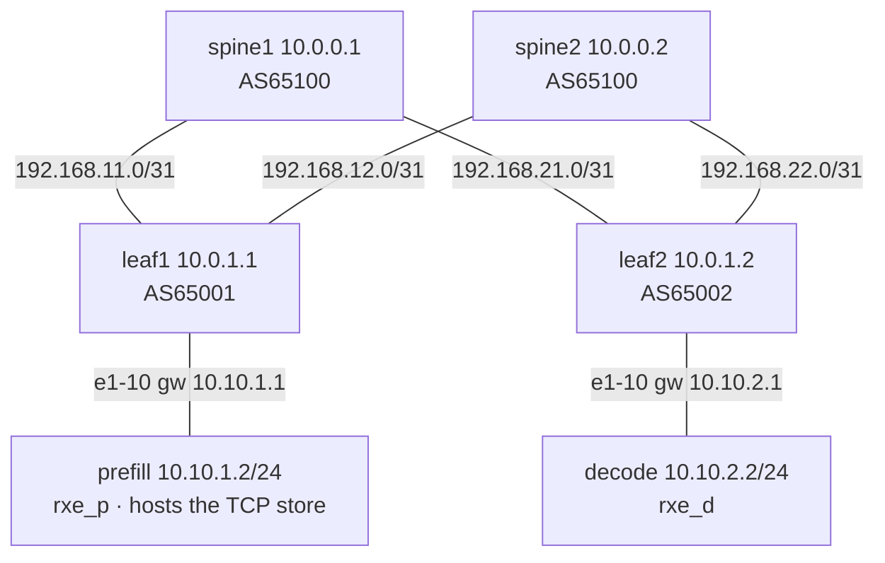
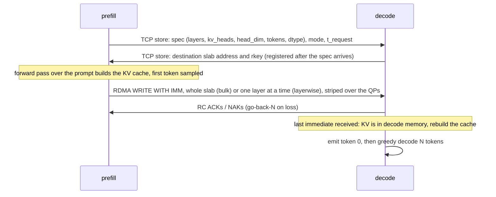

# Disaggregated AI Inference over RoCEv2 on an SR Linux Clos

In disaggregated inference, **prefill** (read the prompt, build the KV cache) and **decode** (generate tokens one at a time) run on different machines. The KV cache that prefill creates must then cross the network before decode can emit its first token. The switches in between see only UDP packets: large, few in number (low entropy) and loss-sensitive.

This lab reproduces that handoff end to end with no GPUs and no RDMA NICs, and follows the layout of [nokia-ai-training-roce-lab](https://github.com/shakeerahmedshaik/nokia-ai-training-roce-lab):

* A **real pretrained LLM** (SmolLM2-135M, 30 layers, 3 KV heads, head dim 64) runs on CPU in two containers. The `prefill` worker processes the prompt and builds the real KV tensors.
* The KV cache moves to the `decode` worker as **real RoCEv2**: UDP/4791, InfiniBand BTH/RETH, RC queue pairs and ACKs, generated by Linux **Soft-RoCE (`rxe`)** on each worker's `eth1`. The transfer is an RDMA WRITE push into memory that decode registered, with the final WRITE carrying an immediate, the "WRITE (push)" example of Learning Byte 04. Only the bootstrap and request metadata use TCP.
* The fabric is a minimal **2-leaf / 2-spine SR Linux Clos** with an eBGP underlay and 2-way ECMP. A RoCE QoS profile is applied: DSCP 26 for data in an ECN-enabled queue, DSCP 48 for CNP in strict priority.

The lab then measures what an AI fabric engineer cares about: whether the answer after the handoff is exactly the answer without it, how much of the first-token time is the network, wire bytes compared with KV bytes, per-QP ECMP placement, loss and go-back-N retransmission, the effect of sender pacing, layer-by-layer streaming, and a spine-link failure in the middle of a transfer.

The background lessons are in [ai-inference-learning-bytes](https://github.com/shakeerahmedshaik/ai-inference-learning-bytes) (Lessons 03 and 04). An **interactive walkthrough** of one request on the wire is in `docs/index.html`; open it with `python3 -m http.server -d docs` and browse to `http://localhost:8000`. The repository is private, so GitHub Pages is not enabled.

## Topology



| Item | Value |
| --- | --- |
| Switches | 4 x SR Linux `ghcr.io/nokia/srlinux:26.7.2`, type `ixr-h5-64o` (7220 IXR-H5-64O, Tomahawk 5) as the TH6 stand-in. See [Platform: TH6 vs TH5](#platform-th6-vs-th5) |
| Workers | 2 x `python:3.11-slim` (Debian 13). PyTorch 2.14 CPU, transformers 4.46.3, rdma-core 56.1, perftest and pyverbs on the system python3 (3.13) |
| Model | SmolLM2-135M (`LlamaForCausalLM`, fp32 weights): 30 layers, 9 attention heads, **3 KV heads**, head dim 64. Greedy decoding, fixed seed, 4 torch threads |
| KV size | `2 x layers x kv_heads x head_dim x tokens x dtype_bytes` = **46,080 B per token** in fp32, 23,040 B in fp16 |
| Underlay | eBGP over /31 links. Spines AS65100, leaves AS65001/65002. Accept-all policy (closed lab fabric), multipath ebgp maximum-paths 2 |
| MTU | Worker eth1 9000, SR Linux subinterface ip-mtu 9000, RoCE path MTU 4096 |
| QoS | Classifier ROCE: DSCP 26 to fc3/unicast-3 (WRED with ECN, 5-20 %), DSCP 48 to fc6/unicast-6 (strict priority) |
| Transfer | RDMA WRITE WITH IMMEDIATE over 1 to 4 RC QPs (channels), traffic class 0x6a (DSCP 26, ECT(0)). `bulk` pushes the whole slab after prefill, `layerwise` pushes each layer as soon as it is computed |

## How a request moves



`app/kvlayout.py` defines the slab: `[layer 0: K | V][layer 1: K | V] ...`, each tensor `[kv_heads, tokens, head_dim]`. One layer is one contiguous byte range (what a layer-wise WRITE pushes) and the whole slab is one contiguous range (what a bulk WRITE pushes). `app/kv_transport.py` registers the slab as an RDMA memory region and stripes each range across the channels. Every channel is its own RC QP, so it gets its own UDP source port and the fabric can hash it onto a different spine.

**Definitions used in every result below** (the two workers share one host clock, so cross-container timestamps are valid):

* `prefill_ms`: the forward pass over the prompt. In `layerwise` mode it includes posting the WRITEs from inside the forward pass.
* `exposed_transfer_ms`: time after prefill (and, in bulk mode, after packing) until every WRITE is acknowledged. This is the network time the user waits for. It is not the whole transfer when the transfer overlaps compute.
* `ttft_ms` (disaggregated): `max(KV fully in decode memory, first token published) - request start`. Decode emits token 0 once it holds the whole cache. Colocated TTFT is `prefill_ms`.
* `wire_MB`: every RoCEv2 frame in both directions on `prefill` eth1 (original frame lengths). `wire/kv` is the amplification over the KV bytes.
* `tokens_and_kv_match`: the generated token ids equal the colocated reference for the same prompt and KV dtype, and the prefill and decode `crc32` of the KV slab are equal.

## Results

Everything below was measured in this lab and the raw output is in `outputs/` (file names in brackets). The host is a shared 10-vCPU VM running other workloads (load average 15 to 22 during the runs), so **absolute milliseconds move by tens of percent between runs**. In the same configuration, `prefill_ms` for 512 tokens ranged from 3.3 s to 7.0 s across the sweep rows. Read the ratios, the byte counts and the exposed transfer time (the network part, which is far steadier) rather than the single TTFT numbers.

### Experiment A: anatomy of one request on the wire (32 tokens, fp32, bulk, 2 channels) [`expA-*`]

The KV slab is 1,474,560 B (32 tokens x 46,080 B). It was pushed as two 737,280 B stripes, one WRITE per RC QP.

| Observation | Value |
| --- | --- |
| RoCEv2 frames, both directions | 513 frames, 1,927,648 B (1.31x the KV bytes) |
| Data frames (opcodes 6, 7, 9) | 463. The ideal is 360 = 2 stripes x (1 First + 178 Middle + 1 Last), so 103 were retransmitted |
| Conversations | `10.10.1.2:60325 -> 10.10.2.2:4791` 243 frames, `10.10.1.2:60656 -> 10.10.2.2:4791` 220 frames. A different UDP source port per QP is the ECMP entropy |
| First WRITE frames | opcode 6 (First) with RETH `dmalen 737280` on each QP, destination QPs `0xa6` and `0xa7`, then opcode 7 (Middle) frames. Last frames are opcode 9 (WRITE Last with Immediate) |
| Marking | DSCP 26, ECN 2 (ECT(0)), TTL 64 leaving prefill and 61 arriving from decode, so three routed hops. No CE marks |
| ECMP | spine1 carried 0.8 MB and spine2 0.9 MB: the two QPs hashed to different spines |
| TCP | 42 frames, 3,611 B: the TCP store carries only the spec, the MR address and rkey, the first token and "done" |
| Timing | prefill 420 ms, `push_done` 475 ms, exposed transfer 52 ms, decode TTFT 483 ms |

### Experiment B: is the answer after the handoff the same answer? (128 tokens, fp32, bulk) [`expB-*`]

| Check | Result |
| --- | --- |
| KV slab crc32 (colocated, prefill, decode) | `e9051a60` on all three |
| Generated token ids, disaggregated vs colocated | identical |
| Control: decode ignores the received KV (`--control zero-kv`) | tokens diverge, so the KV, and nothing else, carries the state |

The 5,898,240 B KV cost 20,747,871 B on the wire (5,151 frames, **3.5x**), because Soft-RoCE sends at host speed into a software datapath that cannot keep up and recovers with go-back-N. Of that, 4,992 frames were data from prefill and 117 were ACKs or NAKs. Only 3.5 KB was TCP. leaf1 `ethernet-1/10` discarded 1,876 packets during the run. `rxe` on prefill counted 32 more sequence errors (`rcvd_seq_err`) and 36 more completer retries, and decode counted 47 more duplicate requests and 34 more out-of-sequence requests, which is go-back-N at work (`retry_exceeded_err` stayed 0). In this run both QPs hashed to the same spine (spine1 12.2 MB, spine2 0 MB): with two flows there is a 50 % chance of a collision, which is why `channels` is a knob.

### Experiment C: time to first token, colocated vs disaggregated (medians of 3) [`expC-ttft-128.txt`, `expC-ttft-512.txt`]

| Prompt | Configuration | TTFT (ms) | prefill (ms) | exposed transfer (ms) |
| --- | --- | ---: | ---: | ---: |
| 128 tokens | colocated | 1004 | 1004 | 0 |
| 128 tokens | disaggregated, bulk | 1508 | 951 | 543 |
| 128 tokens | disaggregated, layerwise | 1901 | 1809 | 172 |
| 128 tokens | disaggregated, layerwise, paced 300 Mbit/s | 1019 | 1009 | 6 |
| 512 tokens | colocated | 5451 | 5451 | 0 |
| 512 tokens | disaggregated, bulk | 7567 | 5313 | 1909 |
| 512 tokens | disaggregated, layerwise | 4928 | 4289 | 226 |
| 512 tokens | disaggregated, layerwise, paced 300 Mbit/s | 7058 | 7002 | 158 |

What holds up despite the noise: with bulk push the handoff adds **about 0.5 s (128 tokens) and 1.9 s (512 tokens)** of exposed transfer on top of prefill, and layer-by-layer push cuts the exposed part to 6 to 226 ms because the WRITEs overlap the forward pass. What does not hold up: the TTFT ordering between layerwise and colocated. In the 512-token rows the `prefill_ms` of the *same* computation ranges from 4.3 s to 7.0 s, which is larger than any difference between the configurations, and Soft-RoCE does its protocol work on the caller's CPU, so layerwise overlap competes with the forward pass for the same cores. On GPUs with RDMA NICs that competition does not exist. **Splitting prefill and decode is not automatically faster for the first token**; it only pays when the handoff is small compared with the work it separates.

### Experiment D: sweeps, one variable at a time (512 tokens unless noted) [`sweeps.txt`]

`wire/kv` is wire bytes divided by KV bytes. Every row passed `tokens_and_kv_match`.

| Sweep | Value | KV (MB) | wire/kv | exposed transfer (ms) | leaf discards |
| --- | --- | ---: | ---: | ---: | ---: |
| prompt length | 32 | 1.5 | 2.30 | 61 | 326 |
| prompt length | 128 | 5.9 | 4.14 | 805 | 2,421 |
| prompt length | 512 | 23.6 | 3.50 | 2,431 | 7,004 |
| prompt length | 1024 | 47.2 | 3.03 | 3,471 | 9,938 |
| KV dtype | fp32 | 23.6 | 3.00 | 1,891 | 4,052 |
| KV dtype | fp16 | 11.8 | 2.64 | 748 | 1,905 |
| channels (RC QPs) | 1 | 23.6 | 2.89 | 2,342 | 4,124 |
| channels (RC QPs) | 2 | 23.6 | 2.83 | 1,684 | 3,599 |
| channels (RC QPs) | 4 | 23.6 | 4.03 | 2,054 | 8,105 |

* KV bytes grow linearly with the prompt (46,080 B per token). fp16 halves the KV bytes and cuts the exposed transfer by 2.5x; the fp16 tokens still match the colocated fp16 reference.
* More channels did not help here. The software datapath is the bottleneck, not the number of QPs, and with 4 QPs there were more retransmissions (wire/kv 4.03). In the 1- and 2-channel rows all flows landed on spine1 (49 MB / 0 MB), so the ECMP benefit of more QPs depends on the hash, not on the count.

### Experiment E: bulk vs layerwise push, three repetitions (512 tokens) [`sweeps.txt`]

| Mode | exposed transfer, runs 1/2/3 (ms) | TTFT, runs 1/2/3 (ms) |
| --- | --- | --- |
| bulk | 1,797 / 1,671 / 1,857 | 6,757 / 5,073 / 6,571 |
| layerwise | 373 / 375 / 708 | 4,158 / 7,346 / 7,018 |

Layerwise reduces the exposed transfer by 62 to 79 % in every repetition. TTFT is inconclusive: layerwise has both the best (4,158 ms) and the worst (7,346 ms) run, because its `prefill_ms` (3,740 / 6,915 / 6,269) includes the CPU cost of posting WRITEs and of Soft-RoCE's receive and ACK work on the same host. The bulk `prefill_ms` was 4,868 / 3,342 / 4,655.

### Experiment F: loss, pacing, delay and transport (512 tokens) [`sweeps.txt`]

| Sender pacing (`tc tbf`) | wire/kv | leaf discards | exposed transfer (ms) | ideal KV / rate (ms) |
| --- | ---: | ---: | ---: | ---: |
| off | 2.94 | 5,141 | 1,722 | n/a |
| 60 Mbit/s | 1.01 | 0 | 3,187 | 3,146 |
| 100 Mbit/s | 1.01 | 0 | 1,918 | 1,888 |
| 150 Mbit/s | 1.04 | 0 | 1,312 | 1,259 |
| 200 Mbit/s | 1.12 | 19 | 1,064 | 944 |
| 300 Mbit/s | 1.43 | 97 | 1,009 | 629 |
| 400 Mbit/s | 1.36 | 10 | 665 | 472 |

The last column is arithmetic (23,592,960 B x 8 / rate), not a measurement. Below about 200 Mbit/s the transfer takes the time the pacer allows and the fabric drops nothing, so the wire carries the KV once (1.01x). Unpaced, the same KV takes about 1.7 s and the wire carries it three times. This is the job that DCQCN or PFC does on a real fabric. The software datapath here does not mark ECN, so pacing is the only available rate control and it has to be set by hand.

| Other variable | Value | wire/kv | exposed transfer (ms) | leaf discards |
| --- | --- | ---: | ---: | ---: |
| netem delay on decode | 0 ms | 2.41 | 1,346 | 2,063 |
| netem delay on decode | 5 ms | 2.60 | 1,426 | 3,019 |
| netem delay on decode | 20 ms | 3.23 | 2,856 | 5,261 |
| transport | RoCEv2 RDMA WRITE (unpaced) | 3.06 | 1,977 | 5,936 |
| transport | TCP (same fabric, same bytes) | 1.03 | 410 | 0 |

Added delay raised the exposed transfer more than the delay itself (20 ms of delay added about 1.5 s), consistent with go-back-N having to wait out round trips before each resend; this lab did not isolate that mechanism. **TCP beat unpaced Soft-RoCE by about 5x** on this fabric, because TCP's congestion control slows down on loss and Soft-RoCE has none. This is a statement about Soft-RoCE on a software datapath with no PFC or DCQCN, not about RoCE on a lossless AI fabric.

### Experiment G: a spine link fails in the middle of a KV transfer [`failover.txt`, `failover-rxe-*.txt`]

Five 1024-token requests, paced at 100 Mbit/s. During the third transfer, 1.5 s after it started, `leaf1 ethernet-1/2` (the uplink that had carried transfer #2) was administratively disabled and re-enabled 16.6 s later.

| Request | exposed transfer (ms) | KV crc32 |
| --- | ---: | --- |
| 0 | 4,279 | `db7b0412` |
| 1 | 3,951 | `db7b0412` |
| 2 (link down 1.5 s in) | 6,372 | `db7b0412` |
| 3 | 3,883 | `db7b0412` |
| 4 | 3,877 | `db7b0412` |

* The affected transfer (request 2) took 6.4 s, about 2.1 to 2.5 s longer than the other four, then completed. Every request produced identical tokens and an identical KV crc32.
* leaf1 withdrew the spine2 path (one next-hop left: `10.10.2.0/24 via 192.168.11.1`). Two next-hops returned about 12 s of polling after the link was re-enabled.
* `retry_exceeded_err` stayed 0 on both sides: the RC retry budget outlasted the reroute, so no QP went into the error state and no request had to be restarted.
* Over these five requests `rxe_p` counted 22 more sequence errors and 53 more completer retries, and `rxe_d` counted 4,111 more duplicate requests.

### What a faster fabric would change (arithmetic, not measured)

The measured fabric moves the KV at roughly 0.1 to 0.5 Gbit/s, which is why the transfer is visible at all. For the handoff alone, at line rate and ignoring protocol overhead:

| KV cache | Bytes | 100 Gb/s | 400 Gb/s | 800 Gb/s | 1.6 Tb/s |
| --- | ---: | ---: | ---: | ---: | ---: |
| SmolLM2-135M, 512 tokens, fp32 | 23.6 MB | 1.89 ms | 0.47 ms | 0.24 ms | 0.12 ms |
| Llama-3-8B-class (32 layers, 8 KV heads, head dim 128), 8,192 tokens, fp16 | 1.07 GB | 85.9 ms | 21.5 ms | 10.7 ms | 5.4 ms |

On a real lossless fabric the question moves from "how fast is the wire" to "how many KV caches arrive at once, and what do they do to each other's tail". The second row is the shape of the problem: large, bursty, few flows. This lab does not test that.

## Deploying the lab

The lab runs with containerlab. `topology.clab.yml` describes the topology, and every switch boots with its startup config from `configs/`.

Soft-RoCE is a host kernel facility, so load it once on the containerlab host **before** deploying:

```bash
sudo modprobe rdma_rxe ib_uverbs sch_netem

# fetch the model once on the host (about 260 MB); it is bind-mounted read-only at /models in both workers
bash scripts/fetch-model.sh

# deploy the lab
containerlab deploy -t topology.clab.yml

# install worker packages, address eth1, create rxe devices, apply RoCE QoS, verify the fabric
bash setup.sh

# destroy the lab
containerlab destroy -t topology.clab.yml --cleanup
```

With the VS Code containerlab extension, open the topology file and click **Deploy**. `topology.clab.yml.annotations.json` holds the Clos layout for the graph view, with spines on top and workers at the bottom. SR Linux needs about 1-2 minutes to boot. `setup.sh` downloads about 250 MB of PyTorch per worker and is intended for a fresh deployment. The lab name, management subnet (172.30.41.0/24) and rxe device names (`rxe_p`, `rxe_d`) differ from the training lab, so the two labs can be deployed side by side, though they then compete for the host's CPUs.

### clabernetes (Kubernetes)

`c9s/ai-inference-c9s.yaml` is the clabverter rendering of this topology (a Namespace, the startup configs and `app/` and `prompts/` files as ConfigMaps, and the Topology resource). It was generated, **not deployed or tested**.

```bash
# regenerate after changing the topology, configs or app/ (the models bind is removed first: 260 MB does not fit in a ConfigMap)
grep -v 'models:/models' topology.clab.yml > /tmp/topology.clab.yml   # run from a directory that also holds app/ configs/ prompts/
docker run --rm --user $(id -u) -v $(pwd):/clabernetes/work \
    ghcr.io/srl-labs/clabernetes/clabverter --stdout --naming non-prefixed \
    --topologyFile topology.clab.yml --destinationNamespace ai-inference |
    sed 's|\${SRL_IMAGE:=\([^}]*\)}|\1|' > c9s/ai-inference-c9s.yaml
```

Kubernetes has constraints the containerlab host does not:

* Soft-RoCE still lives in the host kernel, so run `sudo modprobe rdma_rxe ib_uverbs` on **every cluster node** that can schedule a worker pod.
* The model is not in the manifest. Each worker has internet access, so download it inside the pod to `/models/SmolLM2-135M` (the same eight files as `scripts/fetch-model.sh`), or mount it from a PersistentVolume.
* `setup.sh`, `run.sh` and `scripts/` drive the containers with `docker exec`. On a cluster, run their commands with `kubectl exec` into the worker and switch pods.

## Accessing the network elements

```bash
ssh admin@clab-ai-inference-leaf1
ssh admin@clab-ai-inference-spine1
docker exec -it clab-ai-inference-prefill bash
docker exec -it clab-ai-inference-decode bash
```

| Script | Purpose |
| --- | --- |
| `run.sh infer.py [args] [--wait]` | Starts decode on `decode` and prefill on `prefill`, then prints both `/tmp/infer.log` files. `--role colocated` runs the no-network reference on `prefill`. With `--wait` a wedged or crashed peer is detected and the run is retried once |
| `scripts/compare.sh [tokens] [new]` | Experiment B: colocated, disaggregated (with capture and counters) and the negative control, with a PASS/FAIL verdict |
| `scripts/ttft.sh [tokens] [reps]` | Experiment C: TTFT medians for colocated, bulk, layerwise and layerwise with pacing |
| `scripts/sweep.sh [group...]` | One-variable-at-a-time sweeps, one summary row per run. Groups: `tokens dtype channels mode pacing delay transport` |
| `scripts/failover.sh` | Spine-link failure during a multi-request run |
| `scripts/run-all.sh` | Every experiment above, in order (about 1.5 hours) |
| `scripts/capture.sh start\|stop <name> [--snap N]` | tcpdump on `prefill` eth1, copied to `captures/<name>.pcap` |
| `scripts/analyze.sh <pcap>` | tshark worksheet: totals, conversations, frame sizes, BTH opcodes per QP, DSCP/ECN/TTL, WRITE detail, I/O graph |
| `scripts/fabric.sh [counters]` | BGP sessions, ECMP routes, spine interface counters |
| `scripts/ecmp-delta.py before after` | Spine byte deltas between two `fabric.sh counters` snapshots |
| `scripts/rxe-stats.sh` | Soft-RoCE transport counters (retransmission indicators) and leaf ingress discards |
| `scripts/pace.sh <rate>\|off` | Token-bucket pacing on both workers (stands in for NIC rate control) |
| `scripts/netem.sh add <ms>\|del` | netem delay on `decode` eth1 |
| `scripts/fetch-model.sh [hf-repo]` | Download the model once on the host |

`infer.py` options: `--role prefill|decode|colocated`, `--prompt-tokens N`, `--max-new-tokens N`, `--kv-dtype fp32|fp16`, `--mode bulk|layerwise`, `--channels N`, `--transport roce|tcp`, `--requests N`, `--control zero-kv` (decode only: throw the received KV away).

## Configuration

### Fabric

Each leaf peers with both spines over /31 links and exports its worker subnet. Here is leaf1 (trimmed):

```
set / interface ethernet-1/10 subinterface 0 ip-mtu 9000
set / interface ethernet-1/10 subinterface 0 ipv4 address 10.10.1.1/24
set / interface ethernet-1/1 subinterface 0 ipv4 address 192.168.11.0/31
set / interface ethernet-1/2 subinterface 0 ipv4 address 192.168.12.0/31
set / network-instance default protocols bgp autonomous-system 65001
set / network-instance default protocols bgp afi-safi ipv4-unicast multipath ebgp maximum-paths 2
set / network-instance default protocols bgp neighbor 192.168.11.1 peer-as 65100
set / network-instance default protocols bgp neighbor 192.168.12.1 peer-as 65100
```

### RoCE QoS

`configs/qos-roce.cli` is committed by `setup.sh` on all four switches, with each fabric port's subinterface classifier and output queues bound to it:

```
A:leaf1# info qos classifiers dscp-policy ROCE
    dscp 26 {
        forwarding-class fc3
        drop-probability low
    }
    dscp 48 {
        forwarding-class fc6
        drop-probability low
    }
```

On IXR-H5, `queue-management-profile` on an output queue is rejected unless a `buffer-allocation-profile` sets the queue's `maximum-burst-size`. `enable-ecn` and `slope-enabled` are list keys of `wred-slope`, not leaves.

### Workers

`setup.sh` gives each worker an `rxe` device on `eth1`. Each device has a RoCE v2 GID at index 1, for example `::ffff:10.10.1.2`. The workers are privileged, but `/dev/infiniband/uverbs*` appears on the host only after the device is created, so `setup.sh` also runs `mknod` for those nodes inside each container.

## Platform: TH6 vs TH5

The SR Linux 26.7.2 image recognizes `type: ixr-h6` as the **7220 IXR-H6-64**, the Tomahawk 6 platform. Without a license it stops every application about 20 s after boot, and the container exits. The IXR-H5 types run unlicensed, so this lab uses `ixr-h5-64o` (7220 IXR-H5-64O, Tomahawk 5). To run on IXR-H6, put an SR Linux license file next to the topology and set the following on the four switches:

```
      type: ixr-h6
      license: license.key
```

Either way, containerlab runs SR Linux's control plane and a software forwarding model. It does **not** model Tomahawk queues, MMU headroom, ECN thresholds, PFC state machines, packet trimming, or 400G/800G timing (the ports report 800G but forward in software).

## What this does NOT test

* **No GPUs and none of the production stack.** No vLLM, NIXL, UCX, GPUDirect RDMA, NVLink or a real RDMA NIC. The KV bytes are real (a real model's attention state) and so are the RoCEv2 frames, but the model runs on CPU and the transport is Soft-RoCE written through pyverbs.
* **Absolute speed.** Soft-RoCE and the SR Linux software datapath run at roughly 0.1 to 0.5 Gbit/s here. Use the ratios (`wire/kv`, exposed transfer against KV size, paced against unpaced) and the correctness checks, not the milliseconds, as evidence. The "What a faster fabric would change" table is arithmetic.
* **No ECN, DCQCN or PFC.** The QoS profile is configured and the queues exist, but the software datapath never marked a frame CE (Experiment A, 0 CE), so there is no congestion feedback and the sender has to be paced by hand. A lossless fabric would show far less of the go-back-N amplification seen here.
* **Multi-tenant interference.** One request at a time, one prefill and one decode worker. Many prefill workers incasting into one decode worker, head-of-line effects and tail latency under load are not tested.
* **Real model scale.** 135M parameters with 3 KV heads gives a small KV (46,080 B per token). Production models with more layers and heads, long contexts, paged KV blocks and prefix caching change the size, the number and the shape of the transfers.
* **Noisy shared host.** The VM ran at a load average of 15 to 22 during the runs. `prefill_ms` for the same computation varied by about 2x, so single TTFT numbers and the layerwise-vs-colocated ordering are not conclusive.

## Notes and gotchas

* **Poll loops must sleep.** An early version busy-polled completions on the same cores as the forward pass and made prefill about 2x slower at 128 tokens. `POLL_SLEEP` (0.5 ms) in `app/kv_transport.py` fixed it. The evidence for the artifact is kept in `outputs/artifact-busypoll-ttft-128.txt`.
* **A rare hang.** Once in the runs the prefill process vanished silently and decode waited forever. It did not reproduce in six tries. `run.sh --wait` therefore supervises both sides (a lone survivor for 30 s, or a 900 s timeout, kills the run, prints the logs and retries once on a new store port), and the workers run with `faulthandler` enabled.
* **The KV is compared before it is trusted.** `crc32` of the slab on both sides and the generated token ids against a colocated reference at the same KV dtype (the colocated path quantizes at the same point). A zero-KV control must diverge.
* **Tokens must match at fp16 only because the reference quantizes too.** fp16 KV is lossy in general; the check compares like with like.
* **`sr_cli` startup costs about 2.8 s per call,** so the failover script keeps one persistent session and learns the uplink in use from earlier transfers.
* **ECMP is a hash.** Two QPs can land on the same spine (they did in Experiments B and in the 1- and 2-channel rows). Counters in `fabric.sh` show where each run went.
* **The clabernetes manifest in `c9s/` was generated but not deployed or tested.** The 260 MB model does not fit in a ConfigMap, so the manifest excludes the `models` bind and the model has to be supplied inside the cluster (for example from a volume).
* **Soft-RoCE needs the `rdma_rxe` kernel module on the host** and uses the caller's CPU for protocol work, so `TORCH_THREADS` (default 4) and the host load affect the numbers.

## Raw outputs

Full, unedited command outputs from a run of this lab are in `outputs/`. Captures go to `captures/`, which is git-ignored.

## References

* [ai-inference-learning-bytes](https://github.com/shakeerahmedshaik/ai-inference-learning-bytes): Lesson 03 (disaggregated inference) and Lesson 04 (KV-cache transfer)
* [nokia-ai-training-roce-lab](https://github.com/shakeerahmedshaik/nokia-ai-training-roce-lab): the sibling lab this one follows
* [NVIDIA NIXL architecture](https://docs.nvidia.com/nixl/getting-started/architecture/)
* [linux-rdma/rdma-core](https://github.com/linux-rdma/rdma-core) (rxe, pyverbs) · [perftest](https://github.com/linux-rdma/perftest)
* InfiniBand Architecture Specification, Annex A17: RoCEv2
* [containerlab](https://containerlab.dev) · [SR Linux](https://learn.srlinux.dev) · [SmolLM2](https://huggingface.co/HuggingFaceTB/SmolLM2-135M)
